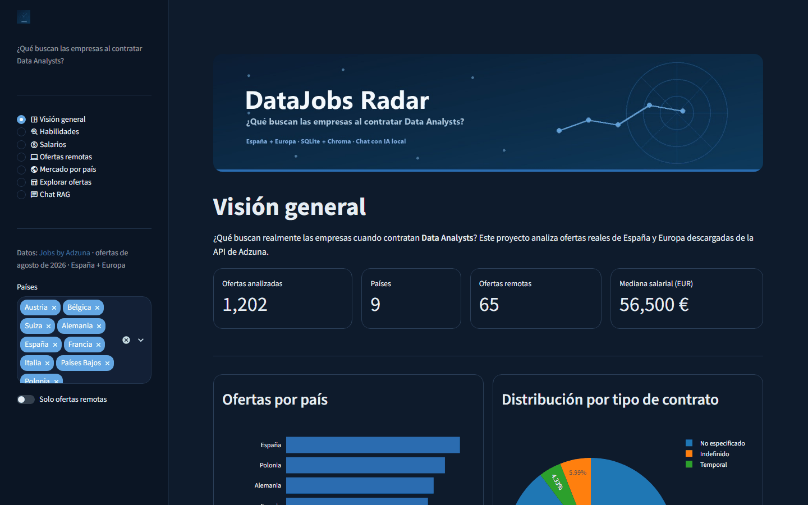
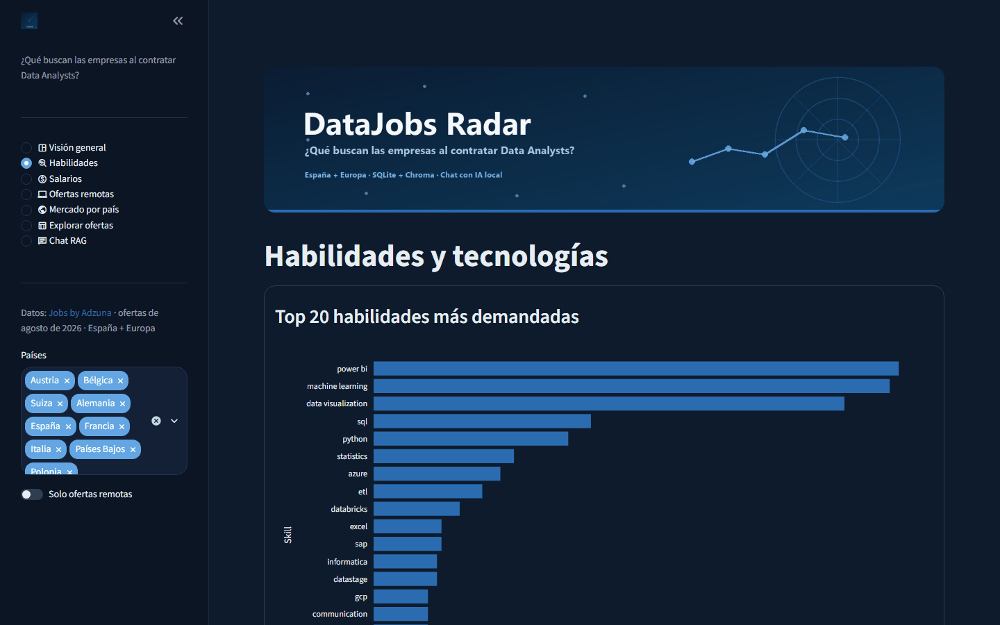

# DataJobs Radar

**Qué piden realmente las empresas a un Data Analyst: habilidades, salarios y teletrabajo en 1.202 ofertas reales de España y Europa.**

[](https://datajobs-radar.vercel.app)    



## En resumen

- **Problema:** quien quiere trabajar como Data Analyst no sabe qué herramientas priorizar ni qué salario esperar en cada país.
- **Datos:** 1.202 ofertas de la API de Adzuna (agosto de 2026) en 9 países, guardadas en SQLite con caché de peticiones.
- **Resultado:** Power BI y la visualización de datos son lo más pedido en ofertas de Data Analyst; la mediana salarial ronda los 56.500 €/año y solo el 5,4 % de las ofertas es remota.
- **App:** 7 secciones en Streamlit (habilidades, salarios, remoto, países, explorador y chat RAG) que funcionan directamente en el navegador.

## El problema que resuelve



Mirando ofertas reales, la app responde preguntas como:

- ¿Qué habilidades piden más para Data Analyst?
- ¿Cuánto se ofrece de salario y cómo varía por país?
- ¿Qué diferencia hay entre Data Analyst, BI Analyst y Data Scientist?
- ¿Qué tecnologías aparecen más: SQL, Python, Power BI, Tableau, Excel, AWS...?
- ¿Qué porcentaje de ofertas son remotas?
- ¿Qué países y ciudades tienen más oportunidades?
- ¿Qué sectores contratan más?
- ¿Qué debería aprender alguien que quiere convertirse en Data Analyst?

## Cómo ejecutarlo

### 1. Requisitos

- Python 3.10+
- Una cuenta gratis en Adzuna para obtener `app_id` y `app_key`
  (https://developer.adzuna.com/signup)
- Opcional para el chat con IA: [Ollama](https://ollama.com) en local

### 2. Instalar dependencias

```bash
python -m venv .venv
.venv\Scripts\activate        # Windows
# source .venv/bin/activate   # Linux/macOS
pip install -r requirements.txt
```

### 3. Configurar las claves

Copia `secrets_ejemplo.toml` como `secrets.toml` y rellena tus claves:

```toml
[adzuna]
app_id = "TU_APP_ID"
app_key = "TU_APP_KEY"
```

`secrets.toml` está en `.gitignore`: nunca lo subas a GitHub.

### 4. Descargar los datos (ingesta)

```bash
python ingesta.py            # descarga lo que falte (cachea en datos.db)
python ingesta.py --force    # ignora el cache y vuelve a pedirlo todo
python ingesta.py --dry-run  # muestra las consultas sin llamar a la API
```

La ingesta hace 72 peticiones a Adzuna y las cachea en la tabla `api_cache`.
Re-ejecutar el script **no gasta peticiones nuevas**: solo descarga lo que
falte. Esto es importante porque el plan gratis de Adzuna son 1000 peticiones.

### 5. EDA

```bash
jupyter notebook notebooks/eda.ipynb
```

O desde VS Code abriendo `notebooks/eda.ipynb`.

### 6. Indexar el corpus para el chat

```bash
python preparar_corpus.py            # indexa las ofertas en Chroma
python preparar_corpus.py --borrar   # reindexa desde cero
```

### 7. Lanzar la app

```bash
streamlit run app.py
```

## Estructura del repositorio

```
Datajob Radar/
├── README.md                este archivo
├── requirements.txt
├── .gitignore
├── secrets_ejemplo.toml     plantilla de claves (sin valores reales)
├── ingesta.py               API de Adzuna -> SQLite (con cache)
├── preparar_corpus.py       ofertas -> Chroma (corpus del chat)
├── skills.py                detección de habilidades/roles en el texto
├── consultas.py             acceso a datos para app y EDA
├── generar_eda.py           genera notebooks/eda.ipynb
├── datos.db                 la base SQLite (se genera al ejecutar ingesta)
├── data/ofertas_demo.db     copia de las ofertas para la demo (sin caché ni claves)
├── index.html               demo web (stlite)
├── diccionario_datos.md     documentación de columnas y tablas
├── notebooks/
│   └── eda.ipynb            análisis exploratorio con conclusiones
└── paginas/
    ├── vision.py            KPIs y contexto
    ├── habilidades.py       top skills y comparativa por rol
    ├── salarios.py          salarios por país y rol
    ├── remoto.py            análisis de ofertas remotas
    ├── pais.py              mercado por país, ciudades y sectores
    ├── ofertas.py           explorador de ofertas
    └── chat.py              chat RAG (Chroma + Ollama)
```

## Notas y limitaciones

- **Adzuna solo devuelve un fragmento de la descripción**, así que las
  habilidades se detectan sobre un texto parcial (SQL/Python pueden estar
  infrarrepresentados).
- **Salarios**: solo una parte de las ofertas publican salario (~18%).
- **Remoto**: Adzuna no tiene filtro, así que se detecta por palabras clave
  (remote, teletrabajo, work from home, etc.).
- **Modelo de embeddings**: Chroma descarga automáticamente `all-MiniLM-L6-v2`
  (79 MB) la primera vez que se indexa.
- **Chat**: en local, los embeddings los calcula Chroma y la generación usa
  Ollama; sin Ollama el chat devuelve las ofertas recuperadas. En la demo web no
  hay Chroma ni LLM: responde a las preguntas de habilidades, salarios y remoto
  con cifras calculadas sobre las ofertas.
- **Demo**: usa `data/ofertas_demo.db`, una copia de las ofertas sin la caché de
  la API y con los enlaces sin parámetros de seguimiento. Son ofertas de agosto de
  2026, así que muchos enlaces ya habrán caducado.
- **Notebook**: se guarda sin salidas; las cifras del resumen final salen de
  ejecutarlo sobre las 1.202 ofertas.

## Licencia y créditos

Datos de empleo: [Jobs by Adzuna](https://www.adzuna.es) ([API](https://developer.adzuna.com)). Uso académico.
